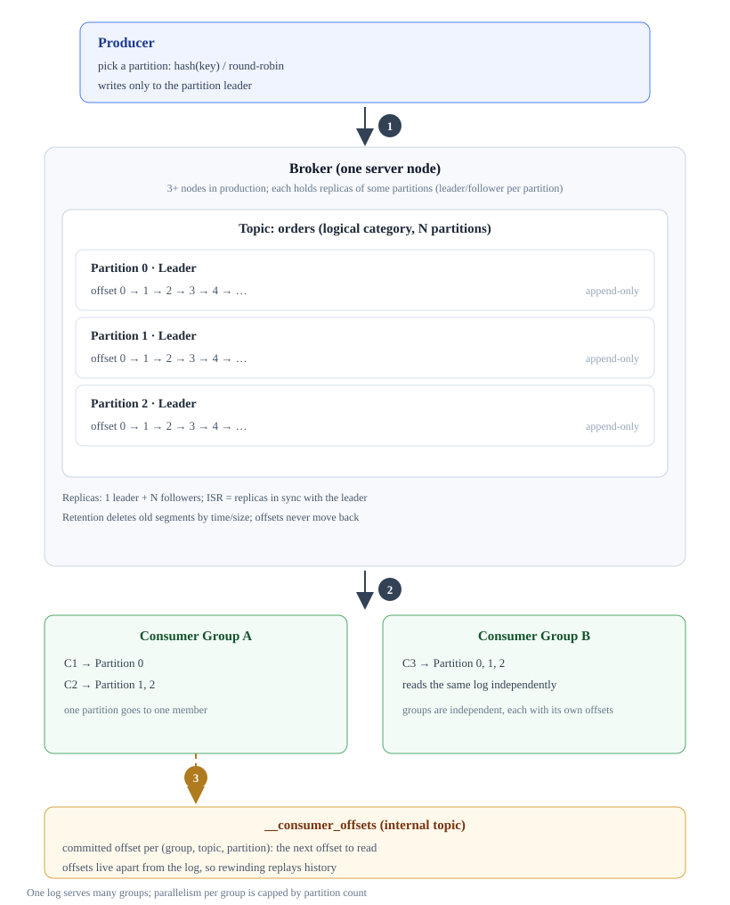

# Kafka in Brief, and Running It Locally

What Kafka is, why it is designed this way, when it fits, and how to bring up a working single-node
cluster on your machine with one `docker run`.

The page starts with the full path of one record, then builds the overall picture around storage,
producers and consumers, and finally drills into replica roles, the on-disk log and write
acknowledgement.

The demo code and startup script live at
[`docs/public/demos/kafka`](https://github.com/zq-xu/zq-xu.github.io/tree/master/docs/public/demos/kafka)
in this site's repository.

## What Kafka is

In short: **Kafka is a distributed commit log that appends records to disk in order, and lets
many consumers read at their own pace.**

Three keywords carry the idea:

- **Sequential writes**: records are only appended to the end of a log, and sequential disk I/O is
  far faster than random writes;
- **Not deleted on delivery**: records expire by a retention policy (time or size), not because
  someone read them, so the same data can be replayed;
- **Independent progress**: every consumer keeps its own offset, so slow and fast consumers do not
  affect each other.

This is what makes it a **high-throughput event streaming platform** rather than a task queue.

## The full path of one record

 topic / partitions inside the broker -> consumer group, with offsets committed to __consumer_offsets">

The diagram splits Kafka into three layers: **clients (producer / consumer)**, **storage inside the
broker (topic / partition / replica)**, and **offset storage (`__consumer_offsets`)**. The numbered
steps ①-③ mark the life of one record; the list below follows that path.

> The diagram shows a single broker for brevity. In reality each partition's replicas are spread
> across brokers; "leader" here means the leader of that partition, not a property of a broker. The
> mechanism section below spells this out.

1. **The producer picks a partition**: with a key it lands on `hash(key) % partitions`; without a key
   it round-robins or sticks to one partition. This choice decides which records share a queue.
2. **The write goes to the partition leader**: the producer only writes to the leader replica; the
   broker appends the record to the end of that partition's log and returns its offset. With
   `acks=all` it also waits for the whole ISR (in-sync replicas) to persist the record (see
   "Write acknowledgement: the three `acks` levels" below).
3. **Followers catch up, forming the ISR**: followers continuously fetch from the leader; replicas
   that keep up stay in the ISR, and a new leader is elected from it if the current one fails.
4. **The record gets an offset inside the partition**: the offset is a line number that increases
   strictly within one partition; there is no order across partitions.
5. **Consumers fetch by offset**: a consumer belongs to a consumer group, and the group assigns
   partitions to members — **one partition belongs to exactly one member at a time**. Different
   groups are independent.
6. **The offset is committed**: after processing, "the next offset to read" is written to
   `__consumer_offsets`. Offsets live apart from the records, so rewinding an offset replays history.
7. **Retention deletes old data**: expired log segments (size- or time-based chunks of the partition
   log) are removed, but offsets are not reset; reading from an already deleted offset yields an
   out-of-range error.

> Only step 2 writes; every other step reads a different position of the same log. That is the
> essential difference between Kafka and a queue that deletes on delivery.

## Concept overview

Kafka's concepts are not a flat list but a containment chain from cluster to partition. The next three
subsections build the overall picture — storage, producers, consumers — and the key mechanisms section
then drills into replica roles, the on-disk log and write acknowledgement.

### Cluster and storage

The containment chain from largest to smallest is:

**Cluster → Broker (one of them also acts as controller) → Topic → Partition → Replica**; an
**offset** is a position inside a partition, a **consumer group** is the unit of assignment on the read
side, and **`__consumer_offsets`** stores each group's progress.

At the cluster level there are two roles: a **broker** stores data; a **controller** maintains
metadata (which topics exist, which broker holds each partition's replicas, who leads which partition)
and decides partition leader elections.

Early Kafka kept that metadata in an external ZooKeeper ensemble. From 3.x it uses built-in
**KRaft (Kafka Raft)** instead: Raft consensus elects a controller inside Kafka, which manages
metadata and replica assignment with no ZooKeeper. The single-node cluster in this guide runs in
KRaft mode, so its one broker also acts as the controller.

| Concept | Level | One-line definition | How it relates to the others |
|---|---|---|---|
| Broker | Cluster | One Kafka server node | A cluster has several brokers; each holds replicas of some partitions |
| Controller | Cluster | Owns metadata, partition assignment and leader election; runs on one of the brokers | **Not a partition leader**; one active controller per cluster |
| Topic | Topic | A logical category of records, like a table name | Contains N partitions fixed at creation; a topic itself has no leader |
| Partition | Partition | A slice of a topic, one append-only log | The unit of ordering and parallelism; each partition has several replicas |
| Replica | Partition | One copy of a specific partition, placed on a broker | Replica count comes from `replication.factor` (a topic setting, but **each partition owns its own replica set**) |
| Offset | Partition | A strictly increasing number inside one partition | Only meaningful within that partition; committed positions are offsets too |

### Producer

The producer is the write client: it chooses a partition, batches, compresses, retries and can be
idempotent. It sends records only to the leader of the target partition; the leader/follower split is
covered under key mechanisms.

- **Partition choice**: with a key it computes `hash(key) % partitions`; without a key it round-robins
  or sticks to one partition, keeping a batch together where possible.
- **Batching and compression**: `batch.size` and `linger.ms` control batch size and waiting time;
  compression happens in the client (`compression.type`) and the broker stores the batch as-is.
- **Write acknowledgement**: `acks` decides how many replicas must confirm before the send returns;
  see the comparison below.
- **Retries and idempotence**: retries can create duplicates; with idempotence enabled
  (`enable.idempotence=true`), the broker deduplicates by producer ID and sequence number.

### Consumers and consumer groups

The consumer is the read client: it fetches records by offset and processes them. Several consumers
can form a consumer group that subscribes to the same topic.

| Concept | One-line definition | How it relates to the others |
|---|---|---|
| Consumer | Read client: fetch by offset and process | Must belong to a consumer group; commits offsets manually or automatically |
| Consumer group | A set of consumers sharing one subscription | Partitions are split exclusively inside the group; groups are independent of each other |
| Group coordinator | Broker-side component managing groups and rebalance | A membership change triggers a rebalance, during which consumption pauses |
| Rebalance | Reassignment of partitions inside a group | Happens when members join/leave or the subscription changes |
| `__consumer_offsets` | Internal topic holding committed offsets | Stores "the next offset to read" per (group, topic, partition) |

Inside one group a partition belongs to exactly one member at a time; different groups keep their own
offsets, so the same log can be read by several groups at different paces.

### Boundaries that are easy to confuse

- **Ordering boundary**: order exists only inside a partition; only the same key is guaranteed to
  land on the same partition.
- **Parallelism boundary**: one group can use at most as many consumers as there are partitions;
  extra consumers just idle (useful as hot standbys).
- **Acknowledgement boundary**: Kafka acknowledges an offset, not an individual record; duplicates
  are handled with idempotent production or transactions.
- **Partition-count boundary**: partitions can only be added, never removed; expanding changes the
  key-to-partition mapping, and existing records are not redistributed.

## Key mechanisms

### Leader and follower: replica roles of a partition

In short: **leader and follower are replica roles of each partition; they belong neither to the
cluster as a whole nor to the topic.**

- A topic is only a collection of partitions and has no leader itself; `replication.factor` is set on
  the topic but applies to each of its partitions.
- The replicas of a partition are spread across brokers; one becomes its leader and the others
  followers. **Every partition elects its own leader independently.**
- So one broker is often the leader of some partitions and the follower of others at the same time.
- The replicas of that partition that keep up with its leader form the **ISR (In-Sync Replicas)**. If
  the leader fails, a new leader is elected from the ISR; `acks=all` waits for the ISR to confirm.
- At the cluster level there is also a controller, which owns metadata and leader election; it is a
  different concept from a partition leader.

Take three brokers, one topic with three partitions and `replication.factor=3`:

| Partition | Leader | Followers | ISR |
|---|---|---|---|
| P0 | Broker 1 | Broker 2, Broker 3 | Broker 1, 2, 3 |
| P1 | Broker 2 | Broker 1, Broker 3 | Broker 1, 2, 3 |
| P2 | Broker 3 | Broker 1, Broker 2 | Broker 1, 2, 3 |

When writing P0, the producer connects to Broker 1 only; Broker 2 and 3 follow it. Broker 1 is also a
follower of P1 and P2, which does not affect its read/write role for P0.

### Log storage: segments, retention and compaction

A partition is a directory on disk, and its log is not one ever-growing file but a series of
**segments**:

- new records append only to the current active segment (the one being written);
- when it reaches `segment.bytes` (1GB by default) or `segment.ms` (7 days), it is sealed and a new
  segment starts;
- deletion works on **whole segments**. When `retention.ms` / `retention.bytes` is exceeded, old
  segments are dropped entirely; Kafka never deletes a few records inside a segment.

So retention means "old data disappears", not "offsets reset": offsets are logical positions and never
go backwards; reading an offset that has been deleted returns an out-of-range error.

How old segments are handled is decided by the topic-level `cleanup.policy`, which has two values:

| Policy | Behaviour | Good for |
|---|---|---|
| `delete` (default) | Drop whole old segments by time or size | Ordinary event streams, log collection |
| `compact` | Do not drop by age; keep only the latest record per key | State snapshots, changelogs, config replication |

`compact` is not a compression codec such as gzip or snappy; it folds history by key. Suppose the same
key is written three times:

| Offset | Key | Value |
|---|---|---|
| 0 | `user-1` | `v1` |
| 5 | `user-1` | `v2` |
| 9 | `user-1` | `v3` |

Once compaction has run, each key ends up with a single record: in the example only offset 9 with `v3`
remains; offsets 0 and 5 are cleaned up, but offset 9 stays where it was, so the log has offset gaps.
To delete a key, write a record whose value is `null` (a tombstone); after `delete.retention.ms` the
tombstone is removed as well.

That also explains the point of compaction: one latest state per key, so a consumer replaying from the
beginning can rebuild the current state. It suits changelogs and state-like topics.

### Write acknowledgement: the three `acks` levels

`acks` is a **producer setting** that decides who must confirm a record before the send counts as
successful.

| Value | Who confirms | Cost and risk | Good for |
|---|---|---|---|
| `0` | No one; the send succeeds immediately | Lowest latency, highest throughput; loss is possible and invisible to the producer if a broker never receives the record or the connection breaks | Logs and metrics where loss is acceptable |
| `1` | The leader, after writing to its local log | Medium latency; if the leader dies before followers fetch it, the new leader may lack the record | Ordinary business data tolerant of rare loss |
| `all` (also `-1`) | Every replica in the ISR | Highest latency, lowest throughput; acknowledged records survive as long as the ISR is large enough | Orders, payments, state changes |

Common points of confusion:

- `acks` lives on the producer; `min.insync.replicas` lives on the broker/topic. Together they define
  the minimum replica count. With `acks=all` and `min.insync.replicas=2`, a write fails with
  `NotEnoughReplicas` when the ISR is smaller than 2 instead of quietly writing only the leader.
- Kafka 3.x producers default to `acks=all`; choosing `0` or `1` explicitly trades reliability for
  throughput.
- Idempotent production requires `acks=all`; with `acks=0/1`, retries can create duplicates.
- `acks` only covers the write to replicas. It says nothing about exactly-once consumption; end-to-end
  exactly-once needs transactions or idempotent consumers.

## Abbreviations at a glance

| Abbreviation | Full name | What it means here |
|---|---|---|
| KRaft | Kafka Raft | Raft-based metadata mode that replaces ZooKeeper; used by this demo |
| ISR | In-Sync Replicas | Replicas keeping up with the leader; `acks=all` waits for them |
| ACK / `acks` | acknowledgement | Producer write acknowledgement: `0` waits for nobody, `1` for the leader, `all` for the ISR; see the table above |
| CDC | change data capture | Turns database changes into an event stream |
| lag | consumer lag | Records a consumer is behind the producer, summed per partition |
| RTT | round-trip time | Time for one network round trip |
| JDK | Java Development Kit | Java toolchain bundled in the demo image |
| CLI | command-line interface | A command-line tool |
| CI | Continuous Integration | The build/test pipeline |
| e2e | end-to-end | Covers the whole path from producing to consuming |
| SASL | Simple Authentication and Security Layer | Auth framework; SASL_SSL = SASL auth + TLS |
| TLS | Transport Layer Security | Transport encryption; mTLS is the mutual variant |
| mTLS | mutual TLS | Both client and server verify each other's certificates |
| SQS | Amazon Simple Queue Service | Queue service hosted by AWS (Amazon Web Services) |

## Core capabilities

- **Read, write and durability**: publish/subscribe, replay by `retention.ms`, the compaction cleanup policy
  (keep the latest record per key)
- **Parallelism and fault tolerance**: partition-level parallelism, replicas and ISR, consumer groups
  with automatic rebalance
- **Ordering and reliability**: per-partition ordering, idempotent production, transactions
- **Ecosystem and governance**: compression (gzip / snappy / lz4 / zstd), Kafka Connect, Kafka
  Streams, quotas and multi-tenancy

## Typical applications

- Log and metric collection
- User behaviour tracking
- CDC (change data capture): binlog → Kafka → cache / search / warehouse
- Event-driven microservices
- Stream processing ingress (Flink / Kafka Streams)
- Traffic smoothing and historical replay
- Event sourcing and audit

## Performance order of magnitude

| Metric | Order of magnitude | Factors |
|---|---|---|
| Single broker writes | Hundreds of thousands to millions of small records/s, hundreds of MB/s | Record size, batching, compression, `acks`, sequential disk writes |
| Single broker reads | Same order or higher | Page cache, fetch size, decompression |
| Latency | `acks=0` sub-millisecond; `acks=1` 1–3 ms; `acks=all` a few ms in one data center (DC) | acks, replica count, cross-DC RTT (round-trip time) |
| Single partition | Commonly around 10 MB/s | One partition is a sequential bottleneck; scale with partitions |
| Retention | TB to PB | Disk capacity, retention policy, compression ratio |

> MB/s, GB, TB and PB in this table are throughput and capacity units (1 PB = 1024 TB).

Public reference points: LinkedIn has reported trillions of messages per day, and Netflix and Uber
operate at millions of events per second.

Measured locally (single Docker broker, single Go client, small records, `acks=all` + idempotence):

| Mode | Result |
|---|---|
| Sync produce (one ACK — acknowledgement — per record) | 9–12 records in 19–29 ms ≈ **400 records/s** |
| Async produce (batched) | 200 records in 15 ms ≈ **13,000 records/s** |

The 30× gap is entirely "waiting for one network round trip per record". When throughput is low,
first check whether the client is sending synchronously, one at a time.

## Choosing Kafka

**Good fit**: high-throughput event streams that must be durable and replayable; several downstream
consumers reading the same data at different speeds; per-key ordering; a stream processing ingress or
CDC; eventual consistency and asynchronous processing are acceptable.

**Poor fit**:

| Scenario | Better choice | Why |
|---|---|---|
| Complex routing, delayed queues, priorities | RabbitMQ | Kafka has no per-message routing or priority |
| Lightweight single-node "just a queue" | Redis Stream / RabbitMQ | Kafka has more moving parts and tuning |
| Task dispatch (per-message ack and retry) | RabbitMQ / SQS (Amazon Simple Queue Service) | Kafka acknowledges at partition-offset granularity |
| Huge multi-tenant setups with tiered storage | Pulsar | Kafka needs extra components |
| Synchronous service calls | gRPC / HTTP | A broker only adds latency |
| Tiny volumes (tens of thousands per day) | A database table / cron job | Operational cost outweighs the benefit |

In one line: **log/event streams + throughput + replay → Kafka; task distribution + fine routing +
low-latency acknowledgement → RabbitMQ-style brokers.**

## Running a single-node Kafka locally

The setup below uses the official Kafka 3.9.1 image in KRaft (Kafka Raft, a metadata mode that
replaces ZooKeeper with a Raft quorum) mode: one node acts as both broker and controller, no
ZooKeeper, and no JDK (Java Development Kit) on the host — everything stays inside the container.

### Prerequisites

| Item | Requirement | Note |
|---|---|---|
| Docker | Docker Desktop / Engine | Docker Desktop on macOS |
| Memory | At least 2 GB for Docker | The broker heap is around 1 GB; leave room for the page cache |
| Port | Host port 9092 free | Port 9093 is the controller and is not published |
| Java | **Not needed** | Bundled in the image |
| Disk | 5 GB+ recommended | Default retention is 7 days, so logs keep growing |

### Option 1: one docker run

Create the volume, then start the container:

```bash
docker volume create kafka-demo-data

docker run -d \
  --name kafka-demo \
  --restart unless-stopped \
  -p 9092:9092 \
  -v kafka-demo-data:/var/lib/kafka/data \
  -e CLUSTER_ID=4L6g3nShT-eMCtK--X86sw \
  -e KAFKA_NODE_ID=1 \
  -e KAFKA_PROCESS_ROLES=broker,controller \
  -e KAFKA_LISTENERS=PLAINTEXT://:9092,CONTROLLER://:9093 \
  -e KAFKA_ADVERTISED_LISTENERS=PLAINTEXT://localhost:9092 \
  -e KAFKA_LISTENER_SECURITY_PROTOCOL_MAP=CONTROLLER:PLAINTEXT,PLAINTEXT:PLAINTEXT \
  -e KAFKA_CONTROLLER_LISTENER_NAMES=CONTROLLER \
  -e KAFKA_INTER_BROKER_LISTENER_NAME=PLAINTEXT \
  -e KAFKA_CONTROLLER_QUORUM_VOTERS=1@localhost:9093 \
  -e KAFKA_OFFSETS_TOPIC_REPLICATION_FACTOR=1 \
  -e KAFKA_TRANSACTION_STATE_LOG_REPLICATION_FACTOR=1 \
  -e KAFKA_TRANSACTION_STATE_LOG_MIN_ISR=1 \
  -e KAFKA_GROUP_INITIAL_REBALANCE_DELAY_MS=0 \
  -e KAFKA_NUM_PARTITIONS=3 \
  -e KAFKA_AUTO_CREATE_TOPICS_ENABLE=true \
  -e KAFKA_LOG_DIRS=/var/lib/kafka/data \
  --health-cmd '/opt/kafka/bin/kafka-topics.sh --bootstrap-server localhost:9092 --list >/dev/null 2>&1 || exit 1' \
  --health-interval 10s \
  --health-timeout 10s \
  --health-retries 10 \
  --health-start-period 30s \
  apache/kafka:3.9.1
```

What each setting does:

| Setting | Value | Purpose |
|---|---|---|
| `--name` / `--restart` | kafka-demo / unless-stopped | Fixed name; comes back after a Docker restart |
| `-p` | 9092:9092 | Host clients connect on 9092 |
| `-v` | kafka-demo-data:/var/lib/kafka/data | Data lives in a named volume, surviving container re-creation |
| `CLUSTER_ID` | fixed string | KRaft cluster ID used when formatting the storage directory |
| `KAFKA_NODE_ID` | 1 | Node ID |
| `KAFKA_PROCESS_ROLES` | broker,controller | One node plays both roles; no ZooKeeper |
| `KAFKA_CONTROLLER_QUORUM_VOTERS` | 1@localhost:9093 | A single-node quorum is itself |
| `KAFKA_LISTENERS` | PLAINTEXT://:9092, CONTROLLER://:9093 | Clients on 9092, controller on 9093 |
| `KAFKA_ADVERTISED_LISTENERS` | PLAINTEXT://localhost:9092 | **The address handed to clients**; wrong value breaks connections |
| `KAFKA_OFFSETS_TOPIC_REPLICATION_FACTOR` | 1 | Must be 1 on a single broker |
| `KAFKA_TRANSACTION_STATE_LOG_*` | 1 / 1 | Replication and min ISR for the transaction topic; also 1 |
| `KAFKA_GROUP_INITIAL_REBALANCE_DELAY_MS` | 0 | Removes the initial rebalance delay for faster local debugging |
| `KAFKA_NUM_PARTITIONS` | 3 | Default partition count for auto-created topics |
| `KAFKA_AUTO_CREATE_TOPICS_ENABLE` | true | Convenient for a demo; disable in production |
| `KAFKA_LOG_DIRS` | /var/lib/kafka/data | Exactly the volume mount point |

The `--health-cmd` probe runs `kafka-topics.sh --list` inside the container: a broker that can list
topics is actually serving. Combine it with `docker inspect` to wait for `healthy` before running
clients, avoiding the "connected but not ready" kind of false failure.

> The classic trap is `ADVERTISED_LISTENERS`: a client connects to 9092 for metadata, and the broker
> addresses in that metadata are exactly the advertised ones. Set it to a container-internal hostname
> and a host-side client will try to connect somewhere it cannot resolve — the symptom is "connects,
> then times out forever".

### Option 2: manage it with the script

Read the raw command once; day to day the script that ships with the demo is easier. The snippet
assumes the repository is already cloned:

```bash
git clone https://github.com/zq-xu/zq-xu.github.io.git
cd zq-xu.github.io/docs/public/demos/kafka

./scripts/kafka.sh start     # create the container if missing, then wait for healthy
./scripts/kafka.sh status    # container status, ports and data volume
./scripts/kafka.sh logs      # follow the broker log (first stop when debugging)
./scripts/kafka.sh stop      # stop the container, keep the data volume
./scripts/kafka.sh restart   # stop + start
./scripts/kafka.sh reset     # remove the container and the volume, back to a clean slate
```

Environment variables override the defaults without editing the file:

```bash
KAFKA_PORT=19092 KAFKA_CONTAINER=kafka-test ./scripts/kafka.sh start
```

Available variables: `KAFKA_IMAGE`, `KAFKA_PORT`, `KAFKA_CONTAINER`, `KAFKA_VOLUME`, `CLUSTER_ID`.

### Verification

Three steps, from "the process is up" to "it reads and writes":

```bash
# 1. The container is running and healthy
docker ps --filter name=kafka-demo
docker inspect -f '{{.State.Health.Status}}' kafka-demo     # expect healthy

# 2. The broker answers metadata requests
docker exec kafka-demo /opt/kafka/bin/kafka-topics.sh \
  --bootstrap-server localhost:9092 --list

# 3. Smoke-test writes and reads with the bundled CLI (command-line interface)
docker exec kafka-demo /opt/kafka/bin/kafka-topics.sh \
  --bootstrap-server localhost:9092 --create --topic quickstart --partitions 3

printf 'hello\nkafka\n' | docker exec -i kafka-demo /opt/kafka/bin/kafka-console-producer.sh \
  --bootstrap-server localhost:9092 --topic quickstart

docker exec kafka-demo /opt/kafka/bin/kafka-console-consumer.sh \
  --bootstrap-server localhost:9092 --topic quickstart --from-beginning \
  --max-messages 2 --timeout-ms 10000

docker exec kafka-demo /opt/kafka/bin/kafka-topics.sh \
  --bootstrap-server localhost:9092 --delete --topic quickstart
```

Reading back the two lines proves "create topic → produce → consume" works on your machine. For
consumer groups, offsets and partitions, the companion [Golang verification
project](./golang-verification.md) exercises each of them.

### Data persistence and container lifecycle

| Operation | Data | Note |
|---|---|---|
| `docker stop` / `docker start` | Kept | Container and volume both stay |
| `docker rm` then `docker run` again | Kept | As long as the volume name is the same |
| `./scripts/kafka.sh reset` | **Deleted** | Container and volume removed; next start is a fresh cluster |
| Upgrading the image | Kept | The same volume works with a newer version; downgrading across majors is not advised |

`docker volume inspect kafka-demo-data` shows where the volume lives.

### Common issues

| Symptom | Likely cause | How to check |
|---|---|---|
| `port is already allocated` | 9092 is taken | `lsof -i :9092`, or use another `KAFKA_PORT` |
| Container stays `unhealthy` | Internal topics not ready, disk full, low memory | `./scripts/kafka.sh logs` |
| Connects but every request times out | `ADVERTISED_LISTENERS` is not `localhost:9092` | `docker inspect` the environment variables |
| `NOT_LEADER_FOR_PARTITION` | Stale metadata (common right after creating a topic) | Retry shortly, or describe once |
| Image pull is very slow | Network / registry mirror | Configure a Docker registry mirror |
| Fails to start on Apple Silicon | Wrong architecture pulled | Use the multi-arch `apache/kafka:3.9.1` image |

### Differences from production

| Item | Local demo | Production |
|---|---|---|
| Nodes | 1 (broker and controller in one process) | At least 3 brokers + 3 controllers |
| Replication factor | 1 | 3 (`min.insync.replicas=2`) |
| Auto topic creation | true | false; topics created by the platform |
| Security | PLAINTEXT (plain text, no auth) | SASL_SSL (SASL auth + TLS) / mTLS (mutual TLS) |
| Monitoring | None | Lag (consumer lag), ISR shrinkage, UnderReplicatedPartitions, disk usage |
| Retention | 7 days by default | Based on value and capacity; tiered storage when needed |

This local setup exists for **functional verification and debugging** only — never put real data on it.

## Related walkthrough

Once the cluster is up, the companion
[Kafka verification with a Golang project](./golang-verification.md) walks through the project
structure, what each subcommand verifies, and what the seven end-to-end assertions cover.
