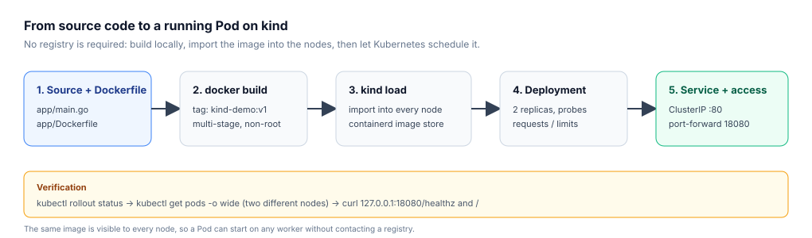

# Deploying a Simple Project on Kind

Deploying a local project on Kind adds one step to the usual Kubernetes workflow: the image must be pushed into the nodes. Kind ships no registry, and each node runs its own containerd, separate from the Docker image store on the host.

This walkthrough uses a small Go service with no external dependencies and runs from building the image to reaching the workload through a Service, with configuration conventions that fit local development and CI. Every command uses the multi-node cluster `kind-multi` and the context `kind-kind-multi`.

## Prerequisites

| Item | Requirement | Check |
| --- | --- | --- |
| Docker | 25 or newer, daemon running | `docker info` |
| Kind | `v0.33.0` | `kind version` |
| kubectl | `1.37.x` | `kubectl version --client` |
| Cluster | a ready `kind-multi` multi-node cluster | `kubectl --context kind-kind-multi get nodes` |

Install commands for Docker, Kind and kubectl are in [Kind Single-Node Deployment](./single-node-deployment) under "Install the dependencies"; creating `kind-multi` is covered in [Kind Multi-Node Deployment](./multi-node-deployment) under "Standard deployment". Continue once every node reports `Ready`.

The sample service, Dockerfile, Kubernetes manifests and scripts live at [`docs/public/demos/kind`](https://github.com/zq-xu/zq-xu.github.io/tree/master/docs/public/demos/kind).

## Sample service and resources

### Sample service

The sample is a Go service with no external dependencies and two endpoints:

| Endpoint | Purpose | Returns |
| --- | --- | --- |
| `/` | business response | hostname and version |
| `/healthz` | health check | `ok` |

The service reads the `PORT` and `APP_VERSION` environment variables and shuts down gracefully. It stays small so that the verification focuses on the deployment flow rather than the business code.

### Deployed resources

| Object | Purpose |
| --- | --- |
| Namespace | isolates the sample resources for group deletion |
| ConfigMap | supplies `APP_VERSION`, decoupling configuration from the image |
| Deployment | manages 2 replicas, probes, resources and rollouts |
| Service | gives the Pods a stable in-cluster access point |
| Image | built from the Dockerfile and loaded into the nodes by `kind load` |

### Project layout

```text
docs/public/demos/kind/
├── app/
│   ├── deploy/
│   │   └── kind-demo.yaml
│   ├── Dockerfile
│   ├── go.mod
│   └── main.go
└── installation/
    ├── single-node/
    │   ├── yaml/
    │   │   ├── kind-single.yaml
    │   │   ├── pvc-check.yaml
    │   │   └── render-config.sh
    │   └── scripts/
    │       ├── kind-single-node.sh
    │       └── restart-node.sh
    ├── multiple-node/
    │   ├── yaml/
    │   │   ├── kind-multi.yaml
    │   │   ├── kind-ha.yaml
    │   │   ├── pvc-check.yaml
    │   │   └── render-config.sh
    │   └── scripts/
    │       ├── kind-multi-node.sh
    │       ├── control-plane-taint.sh
    │       └── restart-nodes.sh
    └── application/
        └── scripts/
            └── kind-demo-deploy.sh
```

`app/` holds the sample code and its deployment manifest; `installation/single-node/` and `installation/multiple-node/` hold the `yaml/` templates, render scripts, persistence checks and `scripts/` for their own layout; the application deployment script lives in `installation/application/scripts/`. Generated `*.local.yaml` files sit next to their templates and are not committed.

All resources are written into a single `kind-demo.yaml` separated by `---`. `kubectl apply` processes the file in order, so the Namespace comes first and the rest can be created in one pass.

## How images reach the nodes

The host Docker image store and the node image store are separate:

```text
host docker build ──> host image store
                         │
                         │ kind load docker-image
                         ▼
              node containerd image store (all nodes)
```

So "the build succeeded" never means "the cluster can run it": `kind load` must push the image into every node (the commands are in "Build and load the image" below). The command imports into all nodes by default; check with `docker exec kind-multi-worker crictl images`. When you import into a subset only, node affinity or a fixed scheduler placement must guarantee the Pod lands on a node that has the image.

Tags must be fixed — never use `:latest`, because Kubernetes defaults to the `Always` pull policy for `:latest` and would bypass the local image. Declare both lines in the Deployment:

```yaml
image: kind-demo:v1
imagePullPolicy: IfNotPresent
```

## Manifest configuration notes

Everything in this section lives in [`app/deploy/kind-demo.yaml`](https://github.com/zq-xu/zq-xu.github.io/blob/master/docs/public/demos/kind/app/deploy/kind-demo.yaml).

### Readiness and liveness probes

| Probe | Effect on failure | When to use it |
| --- | --- | --- |
| `readinessProbe` | removes the Pod from Service endpoints, no restart | stop traffic while startup or a dependency is incomplete |
| `livenessProbe` | restarts the container | unrecoverable faults such as a stuck or deadlocked process |

The sample uses the same `/healthz` for both, but the semantics differ: readiness answers "may it take traffic", liveness answers "should it restart". In production keep liveness away from external services, otherwise an external outage triggers a restart storm.

### Requests and limits

```yaml
resources:
  requests:
    cpu: 50m
    memory: 64Mi
  limits:
    cpu: 200m
    memory: 128Mi
```

- `requests` take part in scheduling and decide whether the Pod fits on a node;
- `limits` cap runtime: CPU is throttled, memory is OOM-killed.

In Kind neither extreme helps verification: values that are too small cause restart loops, values that are too large leave the Pod `Pending` for lack of node resources.

### Multi-node scheduling

The sample uses `topologySpreadConstraints` to place the 2 replicas on different nodes when possible:

```yaml
topologySpreadConstraints:
  - maxSkew: 1
    topologyKey: kubernetes.io/hostname
    whenUnsatisfiable: ScheduleAnyway
    labelSelector:
      matchLabels:
        app.kubernetes.io/name: kind-demo
```

`ScheduleAnyway` schedules even when the spread cannot be perfect, so a shortage of nodes does not block the Pod. Change it to `DoNotSchedule` for strict spreading, but check that enough workers exist first.

If the control planes carry the `NoSchedule` taint, the 2 replicas land on the 2 workers; without it they may also land on a control plane.

### Container security context

The sample container runs as a non-root user with restricted write access:

```yaml
securityContext:
  allowPrivilegeEscalation: false
  readOnlyRootFilesystem: true
  runAsNonRoot: true
  runAsUser: 10001
  capabilities:
    drop:
      - ALL
```

These settings pair with `USER 10001:10001` in the Dockerfile. Changing only the manifest may still let the container start as root; changing only the image leaves the Kubernetes-side guard missing.

### Service access options

Kind does not expose business ports automatically:

| Option | When to use | Advantage | Limitation |
| --- | --- | --- | --- |
| `kubectl port-forward` | local development, one-off verification | zero configuration, cross-platform | dies with the process, not for sharing |
| NodePort + `extraPortMappings` | fixed ports, LAN access | no extra component | requires host port planning |
| Ingress | several services routed by host or path | closest to a production entry | Kind ships no Ingress controller, one must be installed |
| LoadBalancer | an external IP is required | matches cloud semantics | Kind has no LoadBalancer implementation by default |

The verification here uses `port-forward`, which needs no cluster configuration and is enough to confirm that the image and manifests are correct.

### Persistent data

The sample writes no local disk, so the manifest has no PVC. Workloads that need persistence cannot rely on the container file system alone: deleting a Kind node container deletes its data, and the default StorageClass is node-local with `ReadWriteOnce` access, so replicas on different nodes cannot mount the same volume.

Mounting `/var/local-path-provisioner` onto a host directory with `extraMounts` at cluster creation writes the default StorageClass data to the host. On the application side prefer a single-replica Deployment or a StatefulSet for PVC-backed data; sharing one volume across replicas requires external shared storage.

## Deployment flow



1. Build the image in the project directory with the fixed tag `kind-demo:v1`;
2. import it into every node with `kind load docker-image`;
3. create the Namespace, ConfigMap, Deployment and Service with `kubectl apply`;
4. let the Deployment start 2 Pods and attach them to the Service once readiness passes;
5. expose the Service on the host with `kubectl port-forward` and verify health and business responses;
6. for updates repeat build, load, image update and rollout wait.

## Build and load the image

Build the sample image:

```bash
cd zq-xu.github.io/docs/public/demos/kind
docker build -t kind-demo:v1 ./app
```

The Dockerfile uses a two-stage build:

- the build stage compiles a static binary with `golang:1.27-alpine`;
- the runtime stage uses `alpine:3.22` and creates a non-root user with UID 10001;
- only the binary is copied, so sources and compilers never reach the runtime image.

Import the image into every node of the cluster:

```bash
kind load docker-image kind-demo:v1 --name kind-multi
```

Confirm the node has the image:

```bash
docker exec kind-multi-worker crictl images | grep kind-demo
```

## Deploy the resources

Apply everything in one pass. Inside `kind-demo.yaml` the resources are ordered Namespace, ConfigMap, Deployment, Service:

```bash
kubectl --context kind-kind-multi apply -f app/deploy/kind-demo.yaml
```

Wait for the rollout and confirm both Pods are ready:

```bash
kubectl --context kind-kind-multi -n kind-demo rollout status \
  deployment/kind-demo --timeout=180s
```

Inspect the node, IP and state of each Pod:

```bash
kubectl --context kind-kind-multi -n kind-demo get pods -o wide
```

Expected results:

- both Pods are `Running` with `READY` `2/2`;
- the two Pods sit on different worker nodes when possible;
- the Endpoints of Service `kind-demo` list both Pod IPs.

Check the Service and its endpoints:

```bash
kubectl --context kind-kind-multi -n kind-demo get service kind-demo
kubectl --context kind-kind-multi -n kind-demo get endpoints kind-demo
```

## Verify access

Forward the Service to host port `18080` and keep the command running:

```bash
kubectl --context kind-kind-multi -n kind-demo port-forward \
  svc/kind-demo 18080:80
```

In a second terminal:

```bash
curl -i http://127.0.0.1:18080/healthz
curl -i http://127.0.0.1:18080/
```

The business response looks like:

```text
hello from kind
host: kind-demo-7c9f8d6b5-xxxxx
version: v1
```

Repeated requests to `/` alternate the `host` field between the two Pods, which shows the Service spreads traffic across both replicas.

## One-shot deployment

[`kind-demo-deploy.sh`](https://github.com/zq-xu/zq-xu.github.io/blob/master/docs/public/demos/kind/installation/application/scripts/kind-demo-deploy.sh) chains build, load, deployment and verification into one run:

```bash
cd zq-xu.github.io/docs/public/demos/kind
./installation/application/scripts/kind-demo-deploy.sh
```

The script runs these steps in order:

1. check Docker, kind, kubectl and curl;
2. create the cluster through `kind-multi-node.sh` when it does not exist;
3. build `kind-demo:v1` and import it into every node;
4. apply `kind-demo.yaml`, creating the Namespace and all resources at once;
5. wait for the rollout to finish;
6. start a temporary `port-forward` on `127.0.0.1:18080` and request `/healthz` and `/`;
7. close the temporary forward on exit and print the long-lived access command.

Environment variables override the defaults:

```bash
CLUSTER_NAME=kind-dev IMAGE=kind-demo:v1 LOCAL_PORT=18081 \
  ./installation/application/scripts/kind-demo-deploy.sh
```

The script does not delete the namespace, so you can keep investigating afterwards.

## Update and roll back

Build a new tag, load it and point the Deployment at it:

```bash
# build the new tag and load it into every node
docker build -t kind-demo:v2 ./app
kind load docker-image kind-demo:v2 --name kind-multi

# point the deployment at the new image and wait for the rollout
kubectl --context kind-kind-multi -n kind-demo set image \
  deployment/kind-demo app=kind-demo:v2

kubectl --context kind-kind-multi -n kind-demo rollout status \
  deployment/kind-demo
```

Roll back to the previous version:

```bash
kubectl --context kind-kind-multi -n kind-demo rollout undo deployment/kind-demo
```

A ConfigMap change only reaches the Pods after a restart:

```bash
kubectl --context kind-kind-multi -n kind-demo rollout restart deployment/kind-demo
```

## Clean up application resources

```bash
kubectl --context kind-kind-multi delete namespace kind-demo
```

Deleting the Namespace also deletes its Deployment, Service, ConfigMap and Pods, and leaves the Kind cluster and other namespaces untouched. Cleanup targets application resources only; the cluster stays.

## Common issues and troubleshooting

Most of these problems come from local image distribution, host access to Services or node architecture rather than from how the manifest is written.

| Issue | Symptom | Fix |
| --- | --- | --- |
| `kubectl apply` right after `docker build` | no image inside the node, the Pod reports `ErrImagePull` | run `kind load docker-image` first |
| Using `:latest` | the default `Always` policy ignores the local image | use a fixed tag with `IfNotPresent` |
| Loading the image into one node only | the pull fails when the Pod lands elsewhere | load into all nodes, or add node affinity |
| Pod `Pending` | insufficient resources, taints, affinity or a port conflict | `kubectl describe pod` and read the Events |
| `CrashLoopBackOff` | the application fails to start, or the probes are too strict | `kubectl logs`, `kubectl describe pod` |
| `port-forward` refuses the connection | Service port and targetPort do not match | `kubectl get svc -o yaml` and check `targetPort: http` |
| Empty response | the Pod is not ready or the endpoints are empty | `kubectl get endpoints` and wait for readiness |
| Using `port-forward` as a long-lived entry | the connection drops when the terminal closes | share access through NodePort or Ingress |
| Treating a PVC as shared storage | the default StorageClass is node-local | use external storage or pin the scheduling |
| Container starts with `exec format error` | image architecture does not match the node (amd64 built on Apple Silicon, for example) | build with the same `--platform` as the node image |

Ingress is another frequent problem: Kind installs no Ingress controller. The official docs now recommend `cloud-provider-kind` for Ingress and LoadBalancer support, and third-party controllers such as ingress-nginx also work. Either way node labels and port mappings must match.

Read the Pod events to find the cause:

```bash
kubectl --context kind-kind-multi -n kind-demo describe pod <pod-name>
```


