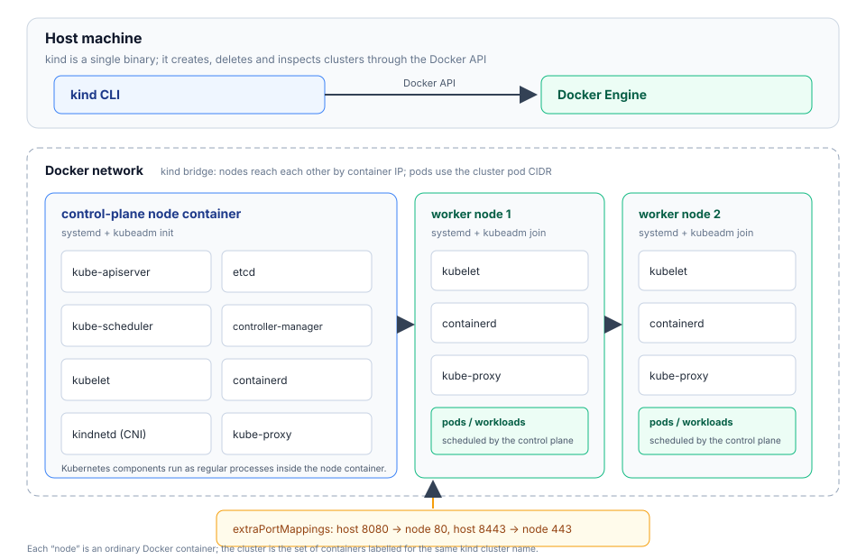

# Kind Overview

Kind (Kubernetes in Docker) runs Kubernetes clusters on a single host by placing each Kubernetes node inside a Docker container. Every container runs `systemd`, `containerd`, `kubelet` and `kubeadm`; together they form a complete cluster that behaves like upstream Kubernetes.

Kind is maintained by Kubernetes SIG Testing. It began as a way to test Kubernetes itself and is now widely used for local development, CI and multi-node behaviour validation. It is a CNCF-certified conformant Kubernetes installer, but it is not a CNCF-hosted project. The former means clusters created by Kind can pass upstream conformance tests; the latter concerns governance. The two should not be conflated.

## Design goals

Kind addresses consistency and reproducibility for local Kubernetes environments. Four design choices follow from that goal:

- **Clusters are made of containers**: no virtual machines, cloud hosts or external nodes; every node is a local Docker container.
- **Versions are fixed by images**: the Kubernetes version comes from the `kindest/node` image, avoiding drift caused by host tooling.
- **Topology is declared in configuration**: node count, roles, port mappings and kubeadm parameters live in a cluster config that can be versioned with code.
- **Lifecycles are disposable**: creation and deletion are explicit commands, making it practical to provision an isolated cluster for every CI job.

These choices define the boundary: Kind targets testing and development, not production.

## Architecture

Kind can be understood as four layers: the host Docker engine, the Docker network, the node containers, and the Kubernetes components and workload Pods inside each node.



| Object | Description |
| --- | --- |
| `kind` CLI | Management entry point. A single Go binary that creates, starts, inspects and deletes node containers through the Docker API. |
| Cluster | Cluster instance. A set of node containers sharing the same kind labels, identified by `--name`. |
| Node container | Node carrier. A Docker container running `systemd` and Kubernetes components, with a control-plane or worker role. |
| Node image | Version carrier. `kindest/node:vX.Y.Z`, preloaded with a specific Kubernetes release. |
| Cluster config | Topology declaration. `kind.x-k8s.io/v1alpha4` YAML describing nodes, networking, port mappings and kubeadm patches. |
| Docker network | Node network. The bridge network created by Kind, assigning node IPs and carrying inter-node traffic. |
| kubeconfig | Access configuration. Host-side credentials whose context is named `kind-<cluster>`. |

Two meanings of "node" need to be kept apart: a Kubernetes Node is the logical object in the cluster, while a Kind node container is the Docker container that hosts it. `kubectl get nodes` shows the former; `docker ps` shows the latter.

## How it works

### Cluster creation

When `kind create cluster` runs, Kind initialises the cluster in this order:

1. Read the cluster config to determine node count, roles, images, networking and port mappings.
2. Create node containers through the Docker API and attach them to the Docker network managed by Kind.
3. Wait for the containers to reach a bootable state, then finish mounts, kubeconfig writes and image preloading.
4. Run `kubeadm init` on the first control plane, `kubeadm join --control-plane` on additional control planes, and a regular `kubeadm join` on workers.
5. Install the default CNI and StorageClass, then merge kubeconfig into the host configuration.
6. Once ready, the cluster is reached with `kubectl --context kind-<cluster>`. On deletion, Kind removes every node container and the network by label.

In terms of responsibility, Docker supplies the node carrier, kubeadm bootstraps the cluster, and kubeconfig returns access to kubectl on the host.

### Inside a node container

`kindest/node` is not an ordinary application image. It contains a node root filesystem with `systemd` boot capability, a container runtime and the Kubernetes components. Startup has four phases:

1. **Prepare**: the entrypoint pauses while Kind completes mounts, configuration writes and image preloading.
2. **Boot init**: after the start signal, `systemd` brings up `containerd` and `kubelet`.
3. **Form the cluster**: control planes run `kubeadm init` or `kubeadm join --control-plane`; workers run `kubeadm join`.
4. **Install add-ons**: apply the default CNI and StorageClass, then export kubeconfig.

As a result, a Kind cluster has two observation planes: Docker shows containers such as `kind-control-plane` and `kind-worker`, while Kubernetes shows the Nodes registered inside those containers.

## Networking

Kind networking has three layers:

- **Node network**: Kind creates a Docker bridge network named `kind`. Each node container receives an IP and nodes communicate through this network.
- **Pod network**: a separate Pod CIDR, `10.244.0.0/16` by default, connected by `kindnetd`.
- **Service network**: `10.96.0.0/12` by default, with forwarding rules maintained by `kube-proxy`. Kind uses iptables mode by default; nftables is available from Kubernetes v1.31.

There are three paths from the host into the cluster:

| Path | Use case | Mechanism |
| --- | --- | --- |
| API server | kubectl, CI, remote debugging | Kind maps the API server to the host, so kubeconfig works directly |
| Port mapping | NodePort, Ingress, fixed-port services | Declare `extraPortMappings` to map a host port to a node container port |
| Temporary forwarding | Local development, one-off checks | Use `kubectl port-forward` without changing cluster configuration |

On macOS and Windows, Docker runs inside a virtual machine and node container IPs are not routable from the host. Workload access must therefore use port mappings or `port-forward`. Node IPs may be reachable on Linux, but port mappings remain preferable for cross-platform consistency.

## Images and storage

### Image distribution

Kind nodes run their own `containerd`, isolated from the host Docker image store. Images produced by `docker build` do not appear in the nodes automatically; they must be loaded explicitly:

```bash
docker build -t kind-demo:v1 ./app
kind load docker-image kind-demo:v1 --name kind-multi
```

By default, `kind load docker-image` imports the image into every node, so a Pod can use the local copy wherever it is scheduled. If only some nodes are loaded, node affinity or fixed scheduling must ensure the Pod lands on a node that has the image.

Image tags should be fixed. Kubernetes defaults to `Always` for `:latest`, which bypasses the local copy and contacts a registry. Workload manifests should also set `imagePullPolicy: IfNotPresent` so the node prefers its local image.

### Persistent storage

Kind installs `local-path-provisioner` and creates a default StorageClass named `standard`. PersistentVolumes live on the local filesystem of a node container by default; mounting that path to a host directory with `extraMounts` writes the data to the host, so files survive a container stop and start or a container recreation. The default storage provides no cross-node sharing.

Two limitations follow:

- A PersistentVolume is bound to one node. A Pod using a PVC may not see the original data after being rescheduled to another node.
- Deleting the cluster deletes node containers and their local data; if the storage path is mounted to a host directory with `extraMounts`, the files remain on the host, but a new cluster does not automatically recognise the old PVC.

Stateless workloads should prefer `emptyDir` or no volume at all. When testing a StatefulSet, accept that data is node-local, or pin the Pod to the same node with affinity.

## Multi-node and high availability

Kind supports multi-node and multi-control-plane topologies:

- **One control plane plus workers**: the usual development and CI shape, used to validate scheduling, affinity, rolling updates and cross-node networking.
- **Three control planes plus workers**: an HA-like layout. Each control plane runs an etcd member and together they form a quorum; Kind starts an additional load balancer container to distribute API server traffic across surviving control planes.

Kind removes the control-plane `NoSchedule` taint by default, so a single-node cluster can run workloads immediately. In a multi-node environment, restore the taint when workloads should run only on workers.

## Lifecycle

Kind keeps cluster state in Docker containers and their labels rather than a separate cluster directory on the host. The common lifecycle commands are:

- `kind create cluster --name <cluster>`: create a cluster; `--image` pins the node image.
- `kind get clusters`: list all local clusters.
- `kind get nodes --name <cluster>`: list the node containers of a cluster.
- `kind export kubeconfig --name <cluster>`: re-export kubeconfig.
- `kind delete cluster --name <cluster>`: remove node containers, the Docker network and the matching kubeconfig entry.

Kubeconfig is merged into `~/.kube/config` by default, with a context named `kind-<cluster>`. When several clusters exist, pass `--context` explicitly to select the intended one.

## Limitations

Kind targets local testing and development. The following limits come from its implementation, not from configuration:

- **Not a multi-host cluster**: all nodes share one host, one kernel and one Docker resource pool, so real cross-machine failure domains cannot be modelled.
- **No cloud-provider capabilities**: there is no LoadBalancer implementation by default. A `type: LoadBalancer` Service receives no external IP unless an additional component is installed; NodePort or Ingress is the usual alternative.
- **Storage is not shared**: the default StorageClass is node-local, and data does not follow a Pod to another node.
- **Resources are bounded by Docker**: the CPU and memory limits of Docker Desktop are the limits of the whole cluster. Multi-node clusters and image builds should have at least 8 GB of memory.
- **Not a security boundary**: node containers share the host kernel; untrusted workloads should not run there.
- **Image architecture must match**: Apple Silicon builds arm64 images by default, and the node image must also be arm64. Cross-architecture builds require an explicit `--platform`.

Common pitfalls and their fixes:

| Pitfall | What happens | Fix |
| --- | --- | --- |
| Deploy immediately after building an image | The image is absent in the nodes and Pods report `ErrImagePull` | Run `kind load docker-image` first |
| Use the `:latest` tag | The default `Always` policy ignores the local image | Use a fixed tag and `IfNotPresent` |
| Reach node IPs directly from macOS | Nodes sit inside a Docker VM and are not routable | Use `extraPortMappings` or `port-forward` |
| Treat Kind as a production cluster | Single host, no failure domains, no cloud integration | Reserve it for development, tests and CI |
| Expect data to survive cluster deletion | Node containers and local volumes are removed; without a host mount the data disappears with the container | Mount a host directory with `extraMounts`, or use external storage |

## Choosing among local tools

Local Kubernetes tools differ in node shape, whether they run upstream Kubernetes, and how complete their built-in components are:

| Tool | Node shape | Best for | Main limitation |
| --- | --- | --- | --- |
| Kind | One Docker container per node; multi-node supported | Testing upstream Kubernetes, CI, multi-node behaviour | No built-in Ingress, LoadBalancer or dashboard |
| Minikube | Mostly single node; some drivers support multi-node | Learning, daily development, official add-ons | Heavier startup; multi-node support depends on the driver |
| k3d | One container per node, running k3s | Lightweight multi-node environments, edge or constrained machines | Runs the k3s distribution, which differs from upstream Kubernetes |
| Docker Desktop Kubernetes | One built-in node | Docker Desktop users who want a quick trial | Single node, limited options, unsuitable for multi-node validation |

Choose by objective:

- Use Kind to validate upstream Kubernetes behaviour, run multi-node scheduling experiments or build CI environments.
- Use Minikube for a ready-made learning environment that relies on Dashboard, Ingress and other add-ons.
- Use k3d when a lighter multi-node cluster is needed and k3s differences are acceptable.
- Use Docker Desktop Kubernetes for a zero-configuration trial inside Docker Desktop.

Kind's value lies in matching the node shape of upstream Kubernetes and reproducing clusters from a declaration, which makes it suitable for testing node changes, taint adjustments and scheduling policies.

## Versions and references

Kind `v0.33.0` ships `kindest/node:v1.37.0` as its default node image and also supports v1.36.4, v1.35.8 and v1.34.11. Kind releases and supported node images are listed in the [official release notes](https://github.com/kubernetes-sigs/kind/releases); cluster configuration fields are documented in the [official configuration guide](https://kind.sigs.k8s.io/docs/user/configuration/).
