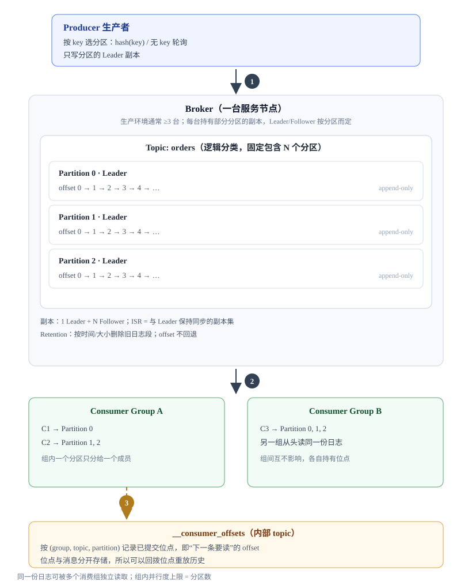

# Kafka 核心模型与选型

Kafka 是一个分布式提交日志：消息只追加到磁盘日志的末尾，多个消费者各自按自己的进度读取同一份数据。它面向高吞吐的事件流场景，而不是逐条投递、读走即删的任务队列。

一条消息的路径贯穿全链路：Producer 选定分区并写入该分区的 Leader 副本，Follower 持续同步形成 ISR，属于某个 Consumer Group 的消费者再按位点拉取。配套代码与启动脚本在仓库 [`docs/public/demos/kafka`](https://github.com/zq-xu/zq-xu.github.io/tree/master/docs/public/demos/kafka)。

## Kafka 是什么

概括地说：**Kafka 是把消息顺序写进磁盘、并允许很多消费者各自按进度去读的分布式提交日志。**

理解这句话的三个关键词：

- **顺序写**：消息只会追加到日志末尾，磁盘顺序写的吞吐远高于随机写；
- **不投递即删**：消息按保留策略（时间或大小）删除，不是被谁读走就消失，所以同一份数据可以被反复回放；
- **各自按进度读**：每个消费者只维护自己的位点（offset），互不干扰，读多读少都不影响别人。

这三点决定了它的定位：**高吞吐的事件流平台**，而不是任务派发队列。

## 一条消息的完整链路

上图把 Kafka 拆成三层：**客户端（Producer / Consumer）**、**Broker 内的存储（Topic / Partition / Replica）**、**位点存储（`__consumer_offsets`）**。图中的 ①～③ 就是一条消息的完整生命线，下面按这个顺序展开。

> 图里为了简洁只画了一个 Broker。实际每个 Partition 的副本会分布在多台 Broker 上；图中的
> Leader 指“这个分区自己的 Leader”，不是某一台 Broker 的身份，后文会专门说明。

1. **Producer 决定写到哪个分区**：带 key 时按 `hash(key) % 分区数` 固定落点，不带 key 时轮询或粘性分配。选分区这一步，决定了这条消息和谁排在同一队里。
2. **写入分区的 Leader**：Producer 只写 Leader 副本；Broker 把消息追加到该分区日志末尾，并返回这条消息的 offset。`acks=all` 时还要等 ISR（In-Sync Replicas，同步副本集合）全部落盘才返回（见后文“写入确认：acks 的三个级别”）。
3. **Follower 同步，形成 ISR**：Follower 持续从 Leader 拉取新消息；跟得上进度的副本留在 ISR 里，跟不上的会被踢出。Leader 故障时，从 ISR 中选新 Leader。
4. **消息在分区内获得 offset**：offset 是分区内的“行号”，严格递增；跨分区之间没有顺序。
5. **Consumer 按位点拉取**：Consumer 属于某个 Consumer Group，组内把 Partition 分给成员——**一个 Partition 同一时刻只属于一个成员**；不同组之间互不影响。
6. **提交位点**：处理完把“下一条要读的 offset”写进 `__consumer_offsets`。位点和消息分开存储，所以回拨位点就能重放历史。
7. **保留策略删除旧数据**：到期的日志段（segment，日志按大小或时间切出的段文件）被整段删除，但位点不会自动重置；按已删除的位点读会得到“越界”错误。

> 整条链路里只有第 2 步在“写”，其余都在读同一份日志的不同位置。这正是 Kafka 与“读走即删”的队列最本质的区别。

## 概念总览

Kafka 的概念不是并列的名词，而是一条从集群到分区的包含链。下面按存储、生产者、消费者三部分展开；副本角色、日志格式与写入确认见“副本、日志与写入确认”。

### 集群与存储

从大到小的包含关系是：

**Cluster → Broker（其中一台兼任 Controller）→ Topic → Partition → Replica**；**Offset** 是 Partition 内的位置，**Consumer Group** 是消费侧的分配单位，**`__consumer_offsets`** 记录每个组的读进度。

集群层有两个角色：**Broker** 是存数据的服务节点；**Controller** 负责维护元数据（有哪些 Topic、每个分区的副本放在哪台 Broker、谁是 Leader），并决定分区 Leader 的选举。

Kafka 早期把这些元数据交给外部的 ZooKeeper 管理；从 3.x 起改为内置的 **KRaft（Kafka Raft）**——用 Raft 共识在 Kafka 内部选出 Controller，由它管理元数据和副本分配，不再依赖 ZooKeeper。本机的单节点集群就是 KRaft 模式，那台 Broker 同时兼任 Controller。

| 概念 | 层级 | 定义 | 与其他概念的关系 |
|---|---|---|---|
| Broker | 集群 | 一个 Kafka 服务节点 | 一个集群由多台 Broker 组成；每台持有若干 Partition 的副本 |
| Controller | 集群 | 负责元数据、分区分配与 Leader 选举，由某台 Broker 兼任 | **不是 Partition 的 Leader**；一个集群同一时刻只有一个 active controller |
| Topic | Topic | 消息的逻辑分类，类似表名 | 固定包含 N 个 Partition，N 在创建 Topic 时确定；Topic 本身没有 Leader |
| Partition | Partition | Topic 的分片，一份只追加的日志 | 并行与有序的最小单位；每个 Partition 在集群内有多份 Replica |
| Replica | Partition | 某个 Partition 的一份拷贝，放在某台 Broker 上 | 副本数由 `replication.factor` 决定（配置在 Topic 上，但**每个 Partition 各自拥有一组副本**） |
| Offset | Partition | 消息在某个 Partition 内的递增编号 | 只在所属 Partition 内有意义；Consumer 提交的位点也是 offset |

### 生产者

Producer 是写客户端，负责选分区、攒批、压缩、重试与幂等。它只把消息发给目标分区的 Leader；Leader 与 Follower 的分工在“关键机制”里说明。

- **选分区**：带 key 时按 `hash(key) % 分区数` 计算落点；不带 key 时轮询或粘性分配，尽量把一批消息留在同一分区。
- **批量与压缩**：`batch.size`、`linger.ms` 决定攒批的大小与等待时间；压缩在客户端完成（`compression.type`），Broker 原样存储。
- **写入确认**：`acks` 决定等几个副本确认后才返回，取值与取舍见后文。
- **重试与幂等**：失败重试可能产生重复消息；开启幂等（`enable.idempotence=true`）后，Broker 会按生产者 ID 与序列号去重。

### 消费者与消费组

Consumer 是读客户端，按位点拉取并处理消息。多个 Consumer 可以组成 Consumer Group，共同订阅同一个 Topic。

| 概念 | 定义 | 与其他概念的关系 |
|---|---|---|
| Consumer | 读客户端：按位点拉取并处理 | 必须属于一个 Consumer Group；可手动或自动提交位点 |
| Consumer Group | 同一份订阅的消费组 | 组内 Partition 独占分配；组间各自独立、互不影响 |
| Group Coordinator | Broker 侧管理组与 rebalance 的组件 | 组成员变化时触发 Rebalance，期间消费暂停 |
| Rebalance | 分区在组内重新分配 | 成员加入 / 离开 / 订阅变化时发生 |
| `__consumer_offsets` | 存位点的内部 Topic | 按 (group, topic, partition) 记录“下一条要读”的 offset |

同一个 Group 内，一个 Partition 同一时刻只分给一个成员；不同 Group 各自维护位点，所以同一份日志可以被多个组按不同进度读。

### 几个容易混淆的边界

- **有序边界**：只在 Partition 内有序；只有同一 key 才保证落同一 Partition。
- **并行边界**：一个 Consumer Group 的并行度上限 = 订阅 Topic 的 Partition 数；多出来的 Consumer 只能空转（可做热备）。
- **确认边界**：Kafka 确认的是“位点”，不是“单条消息 ack”；重复消费要靠幂等生产或事务来兜底。
- **分区数量边界**：分区数只能增加，不能减少；扩容会改变 key 的落点，历史消息不会重排。

## 副本、日志与写入确认

### Leader 与 Follower：分区副本角色

结论先行：**Leader / Follower 是“每个 Partition 自己的副本角色”，既不属于整个集群，也不属于 Topic。**

- Topic 只是分区的集合，本身没有 Leader；`replication.factor` 虽然配在 Topic 上，但作用对象是该 Topic 的每个 Partition。
- 一个 Partition 的副本会分散到多台 Broker，其中一份选为 Leader，其余为 Follower；**每个 Partition 独立选自己的 Leader**。
- 因此同一台 Broker 往往同时是某些 Partition 的 Leader、另一些 Partition 的 Follower。
- 与该 Partition 的 Leader 保持同步的副本集合称为 **ISR（In-Sync Replicas）**；Leader 故障时从 ISR 中选新 Leader，`acks=all` 会等 ISR 确认。
- 集群层面另有一个 Controller，负责元数据与 Leader 选举；它和 Partition Leader 是两个不同概念。

以 3 台 Broker、1 个 3 分区、`replication.factor=3` 的 Topic 为例：

| Partition | Leader | Follower | ISR |
|---|---|---|---|
| P0 | Broker 1 | Broker 2, Broker 3 | Broker 1, 2, 3 |
| P1 | Broker 2 | Broker 1, Broker 3 | Broker 1, 2, 3 |
| P2 | Broker 3 | Broker 1, Broker 2 | Broker 1, 2, 3 |

写 P0 时，Producer 只连 Broker 1；Broker 2、3 作为 Follower 同步。Broker 1 同时还是 P1、P2 的 Follower，但这不影响它作为 P0 Leader 的读写。

### 日志存储：Segment、Retention 与 Compact

Partition 在磁盘上是一个目录，日志不是一个无限增长的大文件，而是被切成多个 **segment**：

- 新消息只追加到当前的 active segment（正在写入的那一段）；
- 当前段达到 `segment.bytes`（默认 1GB）或 `segment.ms`（默认 7 天）就封口，再开一个新段；
- 删除的最小单位是**整个段**。`retention.ms` / `retention.bytes` 到期后，旧段被整段删掉，不会去删段里的某几条。

所以 retention 的效果是“旧数据消失”，不是“offset 归零”：offset 是逻辑位置，不会回退；读一个已经被删掉的 offset，会得到 out-of-range 错误。

旧段具体怎么处理，由 Topic 的 `cleanup.policy` 决定，只有两种取值：

| 策略 | 行为 | 适合的场景 |
|---|---|---|
| `delete`（默认） | 按时间或大小删掉整个旧段 | 普通事件流、日志采集 |
| `compact` | 不按时间删，而是对每个 key 只保留最新一条记录 | 状态快照、changelog、配置同步 |

`compact` 不是 gzip / snappy 那种压缩算法，而是“按 key 折叠历史”。例如同一个 key 写入了三次：

| offset | key | value |
|---|---|---|
| 0 | `user-1` | `v1` |
| 5 | `user-1` | `v2` |
| 9 | `user-1` | `v3` |

compact 生效后，每个 key 最终只剩一条，上例只保留 offset 9 的 `v3`；offset 0 和 5 被清理，但 offset 9 不变，因此日志里会出现 offset 空洞。要删除某个 key，写一条 value 为 `null` 的记录（tombstone，墓碑），超过 `delete.retention.ms` 后连墓碑也会被清掉。

这也解释了 compact 的用途：每个 key 只保留最新状态，消费者从头重放就能重建当前状态，所以它适合 changelog 和状态类 Topic。

### 写入确认：acks 的三个级别

`acks`（acknowledgement，确认）是 **Producer 的参数**，决定“一条消息要等到谁确认，才算写成功”。

| 取值 | 等谁确认 | 代价与风险 | 适合的场景 |
|---|---|---|---|
| `0` | 谁都不等，发出即成功 | 延迟最低、吞吐最高；但可能丢消息：Broker 没收到或网络断了，Producer 都不知道 | 日志、指标等允许丢数据的场景 |
| `1` | 等 Leader 写进本地日志 | 延迟中等；Leader 确认后、Follower 同步前宕机，新 Leader 可能没有这条消息 | 一般业务，能容忍极少量丢失 |
| `all`（也可写 `-1`） | 等 ISR 里所有副本写入 | 延迟最高、吞吐最低；只要 ISR 足够，已确认的消息就不会丢 | 订单、支付、状态变更 |

几个容易混淆的点：

- `acks` 配在 Producer 上；`min.insync.replicas` 配在 Broker / Topic 上，两者配合才决定“最少几份副本”。例如 `acks=all` + `min.insync.replicas=2`：ISR 少于 2 个副本时，写入直接失败（`NotEnoughReplicas`），而不是悄悄只写 Leader。
- Kafka 3.x 的 Producer 默认就是 `acks=all`；改成 `0` / `1` 属于显式用可靠性换吞吐。
- 幂等生产（idempotence）要求 `acks=all`；`acks=0/1` 下重试可能产生重复消息。
- `acks` 只覆盖“写到副本”这一段，不保证消费端只处理一次；端到端精确一次要靠事务或幂等消费。

## 核心能力

- **读写与持久化**：发布订阅、按 `retention.ms` 回放、日志清理策略 compact（按 key 保留最新）
- **并行与容错**：分区并行、副本与 ISR、消费组与自动 rebalance
- **有序与可靠**：分区内有序、幂等生产、事务
- **生态与治理**：压缩（gzip / snappy / lz4 / zstd）、Kafka Connect、Kafka Streams、配额与多租户

## 典型应用场景

- 日志与指标采集
- 用户行为埋点
- CDC（Change Data Capture，变更数据捕获）：binlog → Kafka → 缓存 / 搜索 / 数仓
- 事件驱动微服务
- 流计算入口（Flink / Kafka Streams）
- 削峰填谷、历史数据回放
- 事件溯源与审计

## 性能量级

| 指标 | 量级 | 影响因素 |
|---|---|---|
| 单 broker 写入 | 小消息数十万~百万条/秒，百 MB/s 级 | 消息大小、批量、压缩、`acks`、磁盘顺序写 |
| 单 broker 读取 | 与写入同量级或更高 | 页缓存、拉取批量、解压开销 |
| 延迟 | `acks=0` 亚毫秒；`acks=1` 1~3ms；`acks=all` 同机房几 ms | acks、副本数、跨机房 RTT（round-trip time，网络往返时延） |
| 单分区 | 常见 10MB/s 级 | 单分区是顺序瓶颈，靠多分区扩展 |
| 保留 | TB ~ PB | 磁盘容量 + 保留策略 + 压缩比 |

> 表中 MB/s、GB、TB、PB 均为吞吐与容量单位（1 PB = 1024 TB）。

公开案例量级：LinkedIn 曾公开日均数万亿条消息，Netflix、Uber 也在每秒数百万事件的规模上使用。

本机实测（单机 Docker、单进程 Go 客户端、小消息、`acks=all` + 幂等）：

| 方式 | 结果 |
|---|---|
| 同步生产（逐条等 ACK，acknowledgement 确认） | 9~12 条 / 19~29ms ≈ **400 条/秒** |
| 异步生产（批量攒包） | 200 条 / 15ms ≈ **13000 条/秒** |

差 30 倍全部来自“是否逐条等一个网络往返”。吞吐不够时，先看客户端是不是在同步逐条发。

## 选型建议

**适合**：高吞吐事件流且要落盘可回放；多个下游各自按不同速度消费同一份数据；
需要按 key 有序；要做流处理入口或 CDC；能接受最终一致 + 异步。

**不太适合**：

| 场景 | 更合适 | 原因 |
|---|---|---|
| 复杂路由、延迟队列、优先级队列 | RabbitMQ | Kafka 没有 per-message 路由与优先级 |
| 单机轻量、只要“能用的队列” | Redis Stream / RabbitMQ | Kafka 组件多、调参多 |
| 任务派发（单条确认与重试） | RabbitMQ / SQS（Amazon Simple Queue Service，AWS 托管队列） | Kafka 的确认粒度是分区位点 |
| 超大多租户 + 分层存储 | Pulsar | Kafka 需额外组件 |
| 服务间同步调用 | gRPC / HTTP | 中间件只会加延迟 |
| 数据量很小（每天几万条） | 数据库表 / 定时任务 | 运维成本远大于收益 |

选型可归纳为：**日志 / 事件流 + 高吞吐 + 可回放 → Kafka；任务分发 + 精细路由 + 低延迟确认 → RabbitMQ 类。**

本系列的本地实践使用 Kafka 3.9.1 官方镜像 `apache/kafka:3.9.1`，运行在 KRaft 模式下，集群的创建与验证见 [Kafka 本地部署与运行](./local-deployment.md)。

## 版本与参考

- 本系列版本：Kafka `3.9.1`（KRaft 模式）、Go 客户端 sarama `v1.60.2`。
- [Apache Kafka 官方文档](https://kafka.apache.org/documentation/)：配置项、协议与运维手册的权威来源。
- [KRaft 模式说明](https://kafka.apache.org/documentation/#kraft)：不依赖 ZooKeeper 的元数据管理方式。
- [Kafka配置文档](https://kafka.apache.org/documentation/#configuration)：Broker、Topic 与客户端配置的完整列表。

