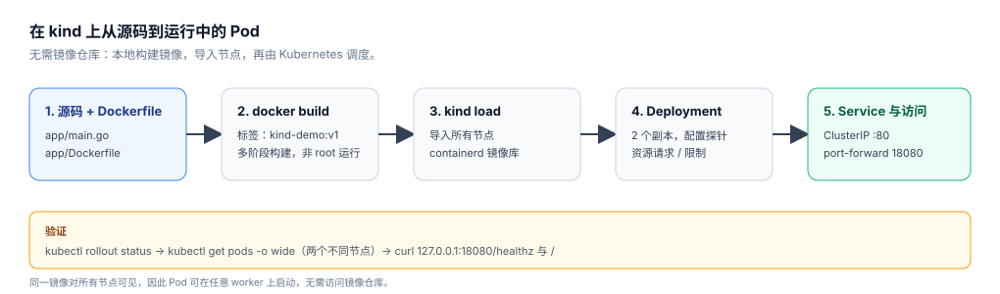

# 在 Kind 中部署简单项目的最佳实践

在 Kind 中部署本地项目，除常规 Kubernetes 操作外，还需要把本地镜像送入节点。部署流程覆盖从构建镜像到通过 Service 访问工作负载的完整过程，并给出适用于本地开发和 CI 的配置约定。

以下操作以名为 `kind-multi` 的多节点集群为前提。

## 部署流程



1. 在项目目录构建镜像，使用固定标签，例如 `kind-demo:v1`；
2. 通过 `kind load docker-image` 将镜像导入集群所有节点；
3. 使用 `kubectl apply` 创建 Namespace、ConfigMap、Deployment 和 Service；
4. Deployment 创建 2 个 Pod，readiness 通过后接入 Service；
5. 通过 `kubectl port-forward` 将 Service 暴露到宿主机，验证健康检查与业务响应；
6. 更新镜像时依次执行构建、加载、更新镜像和等待滚动完成。

概括而言，Kind 不提供镜像仓库，因此必须显式把本地镜像送入节点；除此之外，部署方式与普通 Kubernetes 集群一致。

## 示例服务与部署资源

### 示例服务

示例是一个无外部依赖的 Go 服务，提供两个端点：

| 端点 | 作用 | 返回 |
| --- | --- | --- |
| `/` | 业务响应 | 主机名与版本号 |
| `/healthz` | 健康检查 | `ok` |

服务读取 `PORT` 与 `APP_VERSION` 两个环境变量，并支持优雅退出。服务规模较小，便于将验证重点放在部署流程而非业务代码。

### 部署资源

| 对象 | 作用 |
| --- | --- |
| Namespace | 隔离示例资源，便于整组删除 |
| ConfigMap | 提供 `APP_VERSION`，把配置与镜像解耦 |
| Deployment | 管理 2 个 Pod 副本、探针、资源和滚动更新 |
| Service | 为 Pod 提供稳定的集群内访问入口 |
| 镜像 | 由 Dockerfile 构建，经 `kind load` 进入节点 |

### 镜像与节点镜像库

Kind 的每个节点运行独立的 `containerd`。宿主机的 Docker 镜像库与节点镜像库是两套存储：

```text
host docker build ──> host image store
                         │
                         │ kind load docker-image
                         ▼
              node containerd image store (all nodes)
```

因此，“构建成功”不等于“集群可用”。必须执行 `kind load`，并且保证 Pod 被调度到的节点上有该镜像。

## 部署配置要点

### 镜像加载与标签策略

```bash
docker build -t kind-demo:v1 ./app
kind load docker-image kind-demo:v1 --name kind-multi
```

`kind load docker-image` 默认导入所有节点。可通过 `docker exec kind-worker crictl images` 确认节点内已有镜像。

镜像标签必须固定。不要使用 `:latest`，因为 Kubernetes 对 `:latest` 默认采用 `Always` 拉取策略，会绕过本地镜像去访问仓库。Deployment 中同时显式声明：

```yaml
image: kind-demo:v1
imagePullPolicy: IfNotPresent
```

### 就绪探针与存活探针

| 探针 | 失败后的动作 | 适用目的 |
| --- | --- | --- |
| `readinessProbe` | 把 Pod 从 Service Endpoints 摘除，不重启 | 启动未完成、依赖未就绪时停止接流量 |
| `livenessProbe` | 重启容器 | 进程卡死、死锁等无法自愈的故障 |

示例使用同一个 `/healthz`，但语义不同：readiness 决定“能不能接流量”，liveness 决定“要不要重启”。生产环境应避免让 liveness 依赖外部服务，否则外部故障会引发重启风暴。

### 资源请求与限制

```yaml
resources:
  requests:
    cpu: 50m
    memory: 64Mi
  limits:
    cpu: 200m
    memory: 128Mi
```

- `requests` 参与调度，决定 Pod 能否放到节点；
- `limits` 是运行时上限，超过 CPU 会被限流，超过内存会被 OOM 杀死。

在 Kind 中给太小或太大的值都不利于验证：太小会导致 Pod 频繁重启，太大则可能因为节点资源不足而 `Pending`。

### 多节点调度

示例用 `topologySpreadConstraints` 让 2 个副本尽量落在不同节点：

```yaml
topologySpreadConstraints:
  - maxSkew: 1
    topologyKey: kubernetes.io/hostname
    whenUnsatisfiable: ScheduleAnyway
    labelSelector:
      matchLabels:
        app.kubernetes.io/name: kind-demo
```

`ScheduleAnyway` 表示即使无法完美分散也要调度，避免因为节点不足而 Pending。需要严格分散时改为 `DoNotSchedule`，但要先确认 worker 数量足够。

如果已经给 control-plane 加了 `NoSchedule` 污点，2 个副本会落在 2 个 worker 上；如果没有加，副本也可能落到 control-plane。

### Service 访问方式

Kind 不自动暴露业务端口。常见方式：

| 方式 | 适用场景 | 优点 | 限制 |
| --- | --- | --- | --- |
| `kubectl port-forward` | 本地开发、一次性验证 | 零配置、跨平台 | 进程退出即失效，不适合共享 |
| NodePort + `extraPortMappings` | 固定端口、局域网访问 | 不依赖额外组件 | 需要提前规划宿主机端口 |
| Ingress | 多服务、按域名或路径路由 | 更接近生产入口 | Kind 不内置 Ingress Controller，需要额外安装 |
| LoadBalancer | 需要外部 IP | 语义接近云环境 | Kind 默认没有 LoadBalancer 实现 |

`port-forward` 不依赖集群配置，适合验证镜像与清单是否正确。

### 容器安全上下文

示例容器以非 root 运行，并限制写权限：

```yaml
securityContext:
  allowPrivilegeEscalation: false
  readOnlyRootFilesystem: true
  runAsNonRoot: true
  runAsUser: 10001
  capabilities:
    drop:
      - ALL
```

这些设置与 Dockerfile 中的 `USER 10001:10001` 配套。只改清单不改镜像，容器仍可能以 root 启动；只改镜像不改清单，则缺少 Kubernetes 侧的兜底。

## 常见部署问题与处理

本节汇总在 Kind 中部署应用时容易出现的问题。这些问题多与本地镜像分发、宿主机访问 Service 和节点架构有关，而不是应用清单本身的写法。

| 问题 | 表现 | 处理 |
| --- | --- | --- |
| `docker build` 后直接 `kubectl apply` | 节点内没有镜像，Pod 报 `ErrImagePull` | 先 `kind load docker-image` |
| 使用 `:latest` | 默认 `Always` 拉取，本地镜像被忽略 | 固定标签并设置 `IfNotPresent` |
| 只给一个节点加载镜像 | Pod 调度到其他节点时拉取失败 | 默认加载所有节点，或配合节点亲和 |
| 用 `port-forward` 做长期入口 | 终端关闭后连接断开 | 共享访问使用 NodePort 或 Ingress |
| 把 PVC 当共享存储 | 默认 StorageClass 是节点本地盘 | 需要共享时使用外部存储或固定调度 |
| 在 Apple Silicon 上构建 amd64 镜像 | 节点架构不匹配，容器无法启动 | 构建与节点镜像一致的架构 |

另一个常见问题是 Ingress：Kind 本身不安装 Ingress Controller。官方文档现在推荐 `cloud-provider-kind` 提供 Ingress 与 LoadBalancer 能力，也可以自行安装 ingress-nginx 等第三方控制器。无论哪种方式，都需要节点标签与端口映射配合。

## 命令与配置

| 参数 / 命令 | 含义 |
| --- | --- |
| `docker build -t <tag>` | 构建本地镜像 |
| `kind load docker-image <tag> --name <cluster>` | 把镜像导入指定集群的所有节点 |
| `imagePullPolicy: IfNotPresent` | 本地有镜像时不再拉取 |
| `kubectl rollout status` | 等待 Deployment 完成滚动更新 |
| `kubectl port-forward svc/<name> <local>:<remote>` | 把 Service 端口转发到宿主机 |
| `kubectl get endpoints` | 检查 Service 是否选中了 Ready 的 Pod |
| `kubectl rollout undo` | 回滚到上一个 ReplicaSet |

## 部署步骤

### 项目结构

```text
docs/public/demos/kind/
├── app/
│   ├── Dockerfile
│   ├── go.mod
│   └── main.go
├── deploy/
│   ├── 00-namespace.yaml
│   ├── 10-configmap.yaml
│   ├── 20-deployment.yaml
│   └── 30-service.yaml
└── scripts/
    ├── kind-single-node.sh
    ├── kind-multi-node.sh
    └── kind-demo-deploy.sh
```

清单文件用数字前缀，保证 `kubectl apply -f deploy` 时 Namespace 先于其他资源创建。

### 构建镜像

```bash
cd zq-xu.github.io/docs/public/demos/kind
docker build -t kind-demo:v1 ./app
```

Dockerfile 采用两阶段构建：

- 构建阶段用 `golang:1.25-alpine` 编译静态二进制；
- 运行阶段用 `alpine:3.22`，创建 UID 10001 的非 root 用户；
- 只复制二进制，不把源码和编译工具带进运行镜像。

### 加载镜像并部署

```bash
kind load docker-image kind-demo:v1 --name kind-multi

kubectl --context kind-kind-multi apply -f deploy/00-namespace.yaml
kubectl --context kind-kind-multi apply -f deploy

kubectl --context kind-kind-multi -n kind-demo rollout status \
  deployment/kind-demo --timeout=180s

kubectl --context kind-kind-multi -n kind-demo get pods -o wide
```

期望结果：

- 2 个 Pod 均为 `Running`，且 `READY` 为 `2/2`；
- 两个 Pod 尽量分布在不同的 worker 节点；
- Service `kind-demo` 的 Endpoints 包含两个 Pod IP。

检查 Service：

```bash
kubectl --context kind-kind-multi -n kind-demo get service kind-demo
kubectl --context kind-kind-multi -n kind-demo get endpoints kind-demo
```

### 访问验证

```bash
kubectl --context kind-kind-multi -n kind-demo port-forward \
  svc/kind-demo 18080:80
```

另开一个终端：

```bash
curl -i http://127.0.0.1:18080/healthz
curl -i http://127.0.0.1:18080/
```

业务响应类似：

```text
hello from kind
host: kind-demo-7c9f8d6b5-xxxxx
version: v1
```

多次请求 `/` 可以看到 `host` 在两个 Pod 之间轮换，说明 Service 正在把流量分发到两个副本。

### 一键部署

脚本 [`kind-demo-deploy.sh`](https://github.com/zq-xu/zq-xu.github.io/blob/master/docs/public/demos/kind/scripts/kind-demo-deploy.sh)把构建、加载、部署和验证串成一次执行：

```bash
cd zq-xu.github.io/docs/public/demos/kind
./scripts/kind-demo-deploy.sh
```

脚本按顺序完成：

1. 检查 Docker、kind、kubectl、curl；
2. 集群不存在时调用 `kind-multi-node.sh` 创建；
3. 构建 `kind-demo:v1` 并导入所有节点；
4. 创建 Namespace 并应用全部清单；
5. 等待 Deployment 滚动完成；
6. 在 `127.0.0.1:18080` 启动临时 `port-forward`，请求 `/healthz` 与 `/`；
7. 退出时关闭临时转发，并打印长期访问命令。

可通过环境变量覆盖默认值：

```bash
CLUSTER_NAME=kind-dev IMAGE=kind-demo:v1 LOCAL_PORT=18081 \
  ./scripts/kind-demo-deploy.sh
```

脚本不会自动删除命名空间，便于继续排查。

### 更新与回滚

修改代码后构建新标签：

```bash
docker build -t kind-demo:v2 ./app
kind load docker-image kind-demo:v2 --name kind-multi

kubectl --context kind-kind-multi -n kind-demo set image \
  deployment/kind-demo app=kind-demo:v2

kubectl --context kind-kind-multi -n kind-demo rollout status \
  deployment/kind-demo
```

回滚：

```bash
kubectl --context kind-kind-multi -n kind-demo rollout undo deployment/kind-demo
```

更新 ConfigMap 后需要重启 Pod 才会读取新值：

```bash
kubectl --context kind-kind-multi -n kind-demo rollout restart deployment/kind-demo
```

### 清理应用资源

```bash
kubectl --context kind-kind-multi delete namespace kind-demo
```

删除 Namespace 会一并删除该命名空间下的 Deployment、Service、ConfigMap 与 Pod，不影响 Kind 集群及其他命名空间。

### 故障排查

| 现象 | 常见原因 | 处理 |
| --- | --- | --- |
| `ErrImagePull` / `ImagePullBackOff` | 镜像未加载、标签不一致或使用了 `:latest` | 重新 `kind load`，核对 Pod 所在节点与镜像标签 |
| Pod `Pending` | 资源不足、污点、亲和性或端口冲突 | `kubectl describe pod` 查看 Events |
| `CrashLoopBackOff` | 应用启动失败、探针配置过严 | `kubectl logs`、`kubectl describe pod` |
| `port-forward` 连接被拒绝 | Service 端口或 targetPort 不匹配 | `kubectl get svc -o yaml`，检查 `targetPort: http` |
| 请求返回空响应 | Pod 未 Ready 或 Endpoints 为空 | `kubectl get endpoints`，等待 readiness 通过 |
| 容器启动报 `exec format error` | 镜像架构与节点不一致 | 使用与节点镜像相同的 `--platform` 构建 |

查看节点内镜像：

```bash
docker exec kind-multi-worker crictl images | grep kind-demo
```

查看 Pod 事件：

```bash
kubectl --context kind-kind-multi -n kind-demo describe pod <pod-name>
```
