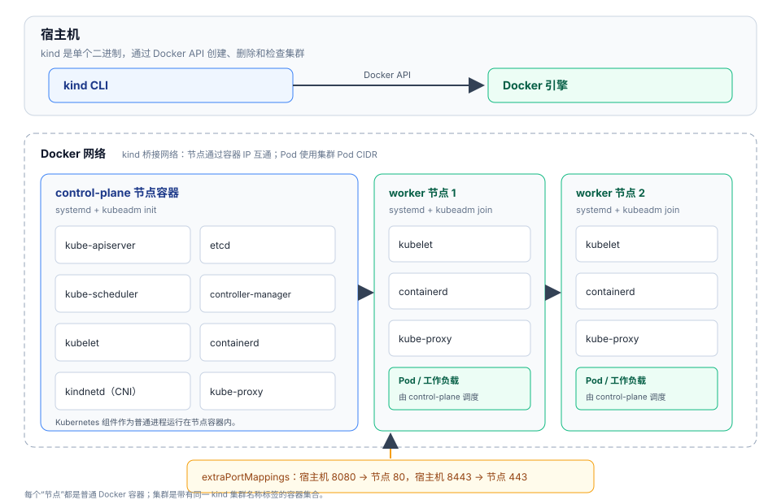

# Kind 项目介绍

Kind（Kubernetes in Docker）是一个在单台主机上运行 Kubernetes 集群的工具。它将每个 Kubernetes 节点封装为一个 Docker 容器，容器内运行 `systemd`、`containerd`、`kubelet` 与 `kubeadm`；多个这样的容器组成一个完整集群，其行为与上游 Kubernetes 保持一致。

Kind 由 Kubernetes SIG Testing 维护，最初用于测试 Kubernetes 自身，后来成为本地开发、CI 和多节点行为验证的常用工具。它是 CNCF 认证的一致性 Kubernetes 安装器，但并非 CNCF 托管项目。前者说明 Kind 创建的集群能够通过上游一致性测试，后者涉及项目治理，两者不应混淆。

## 设计目标

Kind 解决的核心问题是本地 Kubernetes 环境的一致性与可重复性。围绕这一目标，它形成了四项设计特征：

- **集群由容器组成**：不依赖虚拟机、云主机或外部节点，所有节点都是本机 Docker 容器。
- **版本由镜像固定**：Kubernetes 版本由 `kindest/node` 镜像决定，避免宿主机工具链差异带来的漂移。
- **拓扑由配置声明**：节点数量、角色、端口映射和 kubeadm 参数都写在集群配置中，可随代码一起版本化。
- **生命周期可反复重建**：创建与删除都是显式命令，适合在 CI 中为每次任务准备独立集群。

这些特征决定了 Kind 的适用边界：它面向测试与开发，而非生产环境。

## 总体架构

Kind 的架构可以按四层理解：宿主机的 Docker 引擎、Docker 网络、节点容器，以及节点容器内部的 Kubernetes 组件与业务 Pod。



| 对象 | 说明 |
| --- | --- |
| `kind` CLI | 管理入口。单个 Go 二进制，通过 Docker API 创建、启动、检查和删除节点容器。 |
| Cluster | 集群实例。一组带有相同 kind 标签的节点容器，由 `--name` 区分。 |
| Node container | 节点载体。运行 `systemd` 与 Kubernetes 组件的 Docker 容器，分为 control-plane 与 worker。 |
| Node image | 版本载体。`kindest/node:vX.Y.Z`，预装指定版本的 Kubernetes 组件。 |
| Cluster config | 拓扑声明。`kind.x-k8s.io/v1alpha4` YAML，描述节点、网络、端口映射与 kubeadm 补丁。 |
| Docker network | 节点网络。Kind 创建的桥接网络，为节点容器分配 IP 并承载节点间通信。 |
| kubeconfig | 访问配置。宿主机上的集群访问凭证，context 名为 `kind-<集群名>`。 |

需要区分两个“节点”概念：Kubernetes Node 是集群中的逻辑对象，Kind node container 是承载该对象的 Docker 容器。`kubectl get nodes` 查看的是前者，`docker ps` 查看的是后者。

## 工作原理

### 集群创建流程

执行 `kind create cluster` 时，Kind 按以下顺序完成集群初始化：

1. 读取集群配置，确定节点数量、角色、镜像、网络参数和端口映射。
2. 调用 Docker API 创建节点容器，并将节点接入 Kind 管理的 Docker 网络。
3. 等待节点容器进入可引导状态，完成目录挂载、kubeconfig 写入和镜像预加载。
4. 第一个 control-plane 节点执行 `kubeadm init`，其余 control-plane 节点执行 `kubeadm join --control-plane`，worker 节点执行普通 `kubeadm join`。
5. 安装默认 CNI 与默认 StorageClass，并将 kubeconfig 合并到宿主机。
6. 集群就绪后，通过 `kubectl --context kind-<集群名>` 访问 API Server；删除时，Kind 按标签清理全部节点容器与网络。

从职责划分看，Docker 提供节点载体，kubeadm 完成集群引导，kubeconfig 将集群访问权交还给宿主机的 kubectl。

### 节点容器内部

`kindest/node` 不是普通应用镜像，而是一套包含 `systemd` 引导能力、容器运行时和 Kubernetes 组件的节点根文件系统。容器启动分为四个阶段：

1. **准备**：入口进程暂缓启动，等待 Kind 完成目录挂载、配置写入与镜像预加载。
2. **引导 init**：收到启动信号后，`systemd` 拉起 `containerd` 与 `kubelet`。
3. **组建集群**：control-plane 执行 `kubeadm init` 或 `kubeadm join --control-plane`，worker 执行 `kubeadm join`。
4. **安装插件**：应用默认 CNI 与 StorageClass，并导出 kubeconfig。

因此，Kind 集群同时存在两套观察视角：Docker 视角看到的是 `kind-control-plane`、`kind-worker` 等容器；Kubernetes 视角看到的是容器内部注册到 API Server 的 Node。

## 网络模型

Kind 的网络分为三层：

- **节点网络**：Kind 创建名为 `kind` 的 Docker 桥接网络，每个节点容器获得独立 IP，节点间通过该网络通信。
- **Pod 网络**：集群使用独立的 Pod CIDR，默认 `10.244.0.0/16`，由 `kindnetd` 负责连通。
- **Service 网络**：默认 `10.96.0.0/12`，由 `kube-proxy` 维护转发规则。Kind 默认使用 iptables 模式，Kubernetes v1.31 起可配置 nftables。

从宿主机访问集群有三条路径：

| 访问路径 | 适用场景 | 实现方式 |
| --- | --- | --- |
| API Server | kubectl、CI、远程调试 | Kind 将 API Server 端口映射到宿主机，kubeconfig 直接可用 |
| 端口映射 | NodePort、Ingress、固定端口服务 | 在集群配置中声明 `extraPortMappings`，将宿主机端口映射到节点容器端口 |
| 临时转发 | 本地开发、一次性验证 | 使用 `kubectl port-forward`，不修改集群配置 |

在 macOS 与 Windows 上，Docker 运行于虚拟机内部，节点容器 IP 无法从宿主机直接路由。访问工作负载必须使用端口映射或 `port-forward`。Linux 环境下节点 IP 可能可达，但为保持跨平台一致性，仍建议采用端口映射。

## 镜像与存储

### 镜像分发

Kind 节点运行独立的 `containerd`，与宿主机的 Docker 镜像库相互隔离。`docker build` 生成的镜像不会自动出现在节点中，需要通过 `kind load docker-image` 显式导入：

```bash
docker build -t kind-demo:v1 ./app
kind load docker-image kind-demo:v1 --name kind-multi
```

`kind load docker-image` 默认将镜像导入所有节点，使 Pod 无论调度到哪个节点都能使用本地镜像。若只导入部分节点，则必须通过节点亲和性或固定调度保证 Pod 落在已有镜像的节点上。

镜像标签应保持固定。Kubernetes 对 `:latest` 默认采用 `Always` 拉取策略，会绕过本地镜像访问镜像仓库。工作负载清单中应同时声明 `imagePullPolicy: IfNotPresent`，使节点优先使用本地副本。

### 持久化存储

Kind 默认安装 `local-path-provisioner`，并创建名为 `standard` 的默认 StorageClass。PersistentVolume 默认落在节点容器内部的本地路径；通过 `extraMounts` 把该路径挂载到宿主机目录后，数据会写入宿主机，节点容器停止再启动或重新创建时文件仍然存在。默认存储不提供跨节点共享能力。

这一实现带来两个限制：

- PersistentVolume 与节点绑定。使用 PVC 的 Pod 被重新调度到其他节点后，未必能访问原有数据。
- 删除集群会删除节点容器及其本地数据；如果存储路径已通过 `extraMounts` 挂载到宿主机目录，宿主机上的文件会保留，但新集群不会自动识别旧 PVC。

无状态工作负载应优先使用 `emptyDir` 或不声明卷。验证 StatefulSet 时，应接受数据仅存在于单节点本地，或通过亲和性将 Pod 固定在相同节点。

## 多节点与高可用

Kind 支持多节点与多 control-plane 拓扑：

- **单 control-plane + 多 worker**：常见的开发与 CI 形态，用于验证调度、亲和性、滚动更新和跨节点网络。
- **三个 control-plane + 多 worker**：模拟高可用集群。三个 control-plane 各自运行 etcd 成员并形成多数派；Kind 额外启动负载均衡容器，将 API Server 请求分发到存活的 control-plane。

Kind 默认移除 control-plane 的 `NoSchedule` 污点，因此单节点集群可以直接运行工作负载。多节点环境中，如果要求业务仅运行在 worker 上，需要手动恢复该污点。

## 生命周期

Kind 将集群状态保存在 Docker 容器及其标签中，不在宿主机维护独立的集群目录。常用生命周期命令如下：

- `kind create cluster --name <集群名>`：创建集群，可通过 `--image` 固定节点镜像。
- `kind get clusters`：列出本机全部集群。
- `kind get nodes --name <集群名>`：列出指定集群的节点容器。
- `kind export kubeconfig --name <集群名>`：重新导出 kubeconfig。
- `kind delete cluster --name <集群名>`：删除节点容器、Docker 网络及对应 kubeconfig 条目。

kubeconfig 默认合并到 `~/.kube/config`，context 名为 `kind-<集群名>`。存在多个集群时，应通过 `--context` 明确指定目标集群。

## 能力边界

Kind 的定位是本地测试与开发环境。以下限制来自其实现方式，而非配置差异：

- **并非多机集群**：所有节点共享一台宿主机、一个内核和一套 Docker 资源，无法模拟真实的跨机故障域。
- **缺少云厂商能力**：默认没有 LoadBalancer 实现，`type: LoadBalancer` 的 Service 不会获得外部 IP，需要额外组件，或改用 NodePort 与 Ingress。
- **存储不具备共享性**：默认 StorageClass 为节点本地盘，Pod 迁移后数据不会随之迁移。
- **资源受 Docker 约束**：Docker Desktop 的 CPU 与内存上限即集群上限。多节点集群与镜像构建建议至少 8 GB 内存。
- **不构成安全边界**：节点容器共享宿主机内核，不应运行不可信工作负载。
- **镜像架构必须匹配**：Apple Silicon 默认构建 arm64 镜像，节点镜像也必须为 arm64；跨架构构建需显式指定 `--platform`。

常见误区及对应处理：

| 误区 | 实际行为 | 处理方式 |
| --- | --- | --- |
| 构建镜像后直接部署 | 节点内不存在该镜像，Pod 报 `ErrImagePull` | 先执行 `kind load docker-image` |
| 使用 `:latest` 标签 | 默认 `Always` 拉取，本地镜像被忽略 | 使用固定标签并设置 `IfNotPresent` |
| 在 macOS 上直接访问节点 IP | 节点位于 Docker 虚拟机内，宿主机不可路由 | 使用 `extraPortMappings` 或 `port-forward` |
| 将 Kind 用作生产集群 | 单主机、无故障域、无云集成 | 仅用于开发、测试与 CI |
| 删除集群后仍期望保留数据 | 节点容器与本地卷一并删除；未挂载宿主机目录时数据随容器消失 | 用 `extraMounts` 挂载宿主机目录，或使用外部存储 |

## 与同类工具的选型

本地 Kubernetes 工具的差异主要体现在节点形态、是否运行上游 Kubernetes，以及内置组件的完整程度：

| 工具 | 节点形态 | 适用场景 | 主要限制 |
| --- | --- | --- | --- |
| Kind | 每节点一个 Docker 容器，支持多节点 | 测试上游 Kubernetes、CI、多节点行为验证 | 不内置 Ingress、LoadBalancer 与 Dashboard |
| Minikube | 以单节点为主，部分驱动支持多节点 | 学习、日常开发、使用官方 addons | 启动开销较大，多节点能力依驱动而异 |
| k3d | 每节点一个容器，运行 k3s | 轻量多节点、边缘或资源受限环境 | 运行 k3s 发行版，与上游 Kubernetes 存在差异 |
| Docker Desktop Kubernetes | 单个内置节点 | 已使用 Docker Desktop 的开发者快速试用 | 单节点、配置项有限，不适合多节点验证 |

选型可依据目标判断：

- 需要验证上游 Kubernetes 行为、进行多节点调度实验或构建 CI 环境时，选择 Kind。
- 需要开箱即用的学习环境，并依赖 Dashboard、Ingress 等 addon 时，选择 Minikube。
- 需要更轻量的多节点集群，且能够接受 k3s 与上游差异时，选择 k3d。
- 仅需在 Docker Desktop 中零配置试用时，选择内置 Kubernetes。

Kind 的核心价值在于节点形态与上游 Kubernetes 一致，且集群可以按声明重复创建，因此适合验证节点变更、污点调整和调度策略等行为。

## 版本与参考

Kind `v0.33.0` 的默认节点镜像为 `kindest/node:v1.37.0`，同时支持 v1.36.4、v1.35.8 与 v1.34.11。Kind 版本与受支持节点镜像以[官方 release notes](https://github.com/kubernetes-sigs/kind/releases)为准；集群配置字段可参考[官方配置文档](https://kind.sigs.k8s.io/docs/user/configuration/)。
